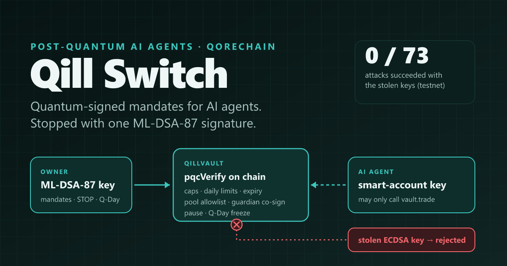

# Qill Switch



**Quantum-signed mandates for AI agents on QoreChain.**

> QoreChain limits where your agent can go. Qill Switch limits what it may do, and stops it with one quantum-safe signature.

The owner gives an AI agent a *mandate*: plain-English instructions compiled into on-chain rules and signed with an
**ML-DSA-87** key. The agent can only act inside the mandate. Anything that loosens control (a new mandate, resume,
withdraw, a new executor, a new owner key) needs the owner's ML-DSA signature, checked on chain by QoreChain's
`pqcVerify` precompile. **A stolen classical ECDSA key alone can never loosen anything.** Trades above a soft limit also
need a co-signature from an independent **guardian** service with its own ML-DSA-87 key. A **Q-Day button** freezes
every vault, revokes every agent key and closes every EVM window, then verifies all of it on chain.

Built during the QoreChain "Build Before Q-Day" Developer Fest, track **Post-Quantum AI Agents**.

## Results (QoreChain testnet `qorechain-diana`)

| What | Result |
|---|---|
| Tests | **94 passing**: 42 Solidity (unit, fuzz ×1000, invariant ×256) + 52 TypeScript; CI runs them on every push |
| Attack bot vs the drill deployment (only the drill account's ECDSA key) | **34 attempts, 0 successes**, 0 value moved ([log](docs/attack-bot-final-drill.txt)) |
| Attack bot vs Steal This Agent (published account key + published agent key) | **39 attempts, 0 successes**, 0 value moved ([log](docs/attack-bot-final-challenge.txt)) |
| Q-Day button on a test fleet | vault frozen, agent key revoked, windows closed in **one round**; the revoked key is then refused by the chain ([log](docs/qday-test-run-1.txt)) |
| Owner `pause()` with a real ML-DSA-87 signature through `pqcVerify` | 283k gas including ~7.5 KB of signature calldata |
| Q-Day Drill (18 Nov 2026) | _to be filled in after the drill_ |

## How it works

```
Owner (ML-DSA-87 key)                 AI agent (secp256k1 linked key)          Attacker (stolen ECDSA key)
  │ mandates · STOP · Q-Day               │ proposes trades                         │
  ▼                                       ▼                                         ▼
Relayer: window scoped to the vault   MsgExecuteEVM via the agent's smart account   rejected: pqc/20, pqc/21,
  (1 tx, exact fee budget, closed)      rule: calls only vault.trade, 1 uqor/day      no EVM window, BadSignature…
  │                                       │        ▲ guardian ML-DSA-87 co-signature above the soft limit
  ▼                                       ▼
              QillVault: pqcVerify(owner/guardian) · mandate · caps · pool allowlist · pause · Q-Day
```

- **Mandates** ([packages/mandate](packages/mandate)): plain English → template parser or LLM structured output (Gemini or Claude, [packages/llm](packages/llm)) →
  a deterministic validator (no missing or zero limits, ≤ 30 days, known pools/tokens only, global ceilings) → vault
  params + the smart-account rule + `textHash`/`rulesHash`, all signed together by the owner.
- **Vault** ([contracts/src/QillVault.sol](contracts/src/QillVault.sol)): no `msg.sender` owner. Every owner action is
  `keccak256(pubkey) == ownerKeyHash` + nonce + expiry + `pqcVerify` over a domain-separated message.
- **Agent** ([apps/agent](apps/agent)): fails closed, acts only on a mandate file whose hashes match the chain, sizes
  trades deterministically; the LLM only writes the reasoning note.
- **Guardian** ([apps/guardian](apps/guardian)): separate process; on-chain facts, a deterministic veto policy, an
  optional LLM review that can only veto, and a simulation of the exact trade before it signs.
- **Owner tools**: `qill` CLI ([apps/cli](apps/cli)) and a dashboard ([apps/dashboard](apps/dashboard)) whose actions
  are signed by a localhost API, never in the browser.

## Track features → code

| Required feature | Where |
|---|---|
| **Scoped EVM window** | [packages/chain/src/cosmos.ts](packages/chain/src/cosmos.ts) `openWindow` (refuses unscoped windows except the one-off deploy) and [packages/chain/src/vault.ts](packages/chain/src/vault.ts) `relayToVault`: window with `allowedTargets = [vault]`, `maxTxs = 1`, `maxValue` = the exact max fee, ≤ 120 blocks; closed and verified closed |
| **Limits on transactions, value, duration and target** | [QillVault.sol](contracts/src/QillVault.sol) `trade`: per-trade cap, UTC-daily cap, mandate expiry, pool and token allowlists, guardian above the soft limit. Windows: `maxTxs`, `maxValue`, `blocks`, `allowedTargets`. Smart-account rule: 1 uqor native per execution and per day |
| **Smart-account spending rules** | [packages/chain/src/aa.ts](packages/chain/src/aa.ts) `agentRule`, `linkAgentKey`, `setRules`: one enabled rule bounding every denom, `allowed_evm_calls = ["<vault>/<trade selector>"]`, always a full replace followed by a read-back diff; agent key linked with the `evm` permission only. Compiled from the mandate in [packages/mandate/src/compile.ts](packages/mandate/src/compile.ts) |
| **Authenticated messaging** | [QillMessage.sol](contracts/src/libraries/QillMessage.sol) and [packages/pq/src/message.ts](packages/pq/src/message.ts): `abi.encode("QILLSWITCH_V1", chainid, vault, action, keccak256(params), nonce, expiry)` signed with ML-DSA-87 and verified on chain by `pqcVerify` in `QillVault._authOwner` / `_authGuardian`; cross-language test vectors |

## Run it

Full walkthrough from a clean clone: **[docs/DEMO.md](docs/DEMO.md)**. The short version:

```sh
git clone --recurse-submodules https://github.com/CapThunder19/Qill-Switch && cd Qill-Switch
pnpm install && pnpm --filter @qill/contracts build && pnpm test
pnpm qill mandate compile "Trade QTA and QTB on demo-pool. Max 50 per trade, 150 per day, guardian above 20, for 5 days."
pnpm qill mandate submit mandates/<id>.json
pnpm guardian & pnpm agent --once
pnpm qill stop          # the agent now fails closed
pnpm qill qday --fleet qday-test
pnpm attack && pnpm attack --target challenge
```

## Steal This Agent

A separate deployment publishes **two private keys**: the classical key of an account holding bait QOR, and the AI
agent's own linked key. Every trade needs our guardian's ML-DSA-87 co-signature (soft limit 0); the agent key may only
call `vault.trade` and move at most 1 uqor per day, and its smart account holds 0. Page: [apps/challenge](apps/challenge)
(live on-chain scoreboard + in-browser attack console), published through the manual `challenge-pages` workflow.
Integrity check and refill: `pnpm challenge:refill`.

## Testnet addresses

EVM chain id 9800. Full records in [deployments/](deployments).

| Deployment | QillVault | Pool | Token A / Token B |
|---|---|---|---|
| **Drill** ([record](deployments/qorechain-diana.json)) | `0x6B06108FB72c3E93eCa391E5DabeE4F141e9D365` | `0x87d69892fe9019004e38eCC5cf746Ee67b44CE4C` | `0xB1253Fe7f230Fa0e58D8a97Bb2142AE5250FB18A` / `0xB7484fa7Bc3D44B20E58941528A2dCFdA6B2DEFD` |
| Demo ([record](deployments/demo.json)) | `0xd6311846F282FBd2Fc486f2FbA1b85c5Ba16d8A3` | `0x951c8304D7DCa38321c041138DA22e94956fe4B3` | `0xE75F85Fe7d816ae9CA1D133CDe787747CB9C3239` / `0xC380E4f165E59EeE3a1CC7Dad4B4514D48e52149` |
| Steal This Agent ([record](deployments/challenge.json)) | `0xaaDc82Ed0a27aA89F38F02e848B649018AD17e90` | `0x91D185b3F8Bb251717Ff0BBfE7A5978432cBBf95` | `0x8bf1dc453B8968D641DB349dd183da2d4B9B6Ff7` / `0x2f504123C92D807860E9F2C5C40435554C9e38D9` |
| Q-Day test, frozen ([record](deployments/qday-test.json)) | `0xF4e78f837E2c6Eb4A1076A3101edbF5ff458890f` | | |

| Account | Address |
|---|---|
| Drill account (ML-DSA-87 registered with proof of possession) | `0x93c91b9c0ae17023FDe445c99Cb435557FA10499` / `qor1j0y3h8q2u9cz8l0yghyeedp424l6zpyej8e06l` |
| Demo agent smart account (demo vault executor) | `0xFAA88a00c956f695bBce8eeee86D39d46DfC7723` |
| Challenge account (key published) | `0x2A2F8F87C3C422E3369fA45dCE8de9269f685b66` |
| Challenge agent smart account / published agent key | `0xA073EcFEF809651162AEDf3bdeB776E4cAcaA922` / `0x828fA45077fa6cA0616D650E9914bB2Eb03D95C3` |

A further set (`QillVault 0xDf8fb77C…78c7`) was deployed by mistake through a tooling error, then paused by owner
signature; it is recorded in [deployments/qorechain-diana-accidental-2.json](deployments/qorechain-diana-accidental-2.json)
and plays no part in the project.

## Documents

| | |
|---|---|
| [THREAT_MODEL.md](THREAT_MODEL.md) | assets, adversaries, every control, findings, residual risks |
| [DRILL_RUNBOOK.md](DRILL_RUNBOOK.md) | Q-Day Drill registration details, normal transaction, panic, never-do list |
| [docs/SPIKES.md](docs/SPIKES.md) | what we verified on testnet before building (ML-DSA encoding, windows, smart accounts, `MsgExecuteEVM`) |
| [docs/DEMO.md](docs/DEMO.md) | clean-clone walkthrough |
| [docs/VIDEO_SCRIPT.md](docs/VIDEO_SCRIPT.md) | the 3-minute demo script |
| [AI_USAGE.md](AI_USAGE.md) | how AI was used to build this, and how AI runs inside it |

## Repo layout

```
contracts/        Hardhat 3: QillVault, QillMessage, IQorePQC, mocks, Solidity tests (forge-std style)
packages/pq       ML-DSA-87 helpers, canonical message encoding, key files
packages/chain    accounts, hybrid Cosmos txs, windows, relayer, smart accounts, vault client, Q-Day
packages/mandate  mandate schema, template parser, validator, compiler, LLM extraction
packages/llm      provider-neutral LLM layer: Gemini (default when GEMINI_API_KEY is set) or Claude
apps/cli          qill: the owner CLI
apps/agent        treasury agent
apps/guardian     guardian service
apps/dashboard    dashboard + localhost signer API
apps/challenge    Steal This Agent page
apps/attack-bot   replays every drill and challenge attack
fleet/            Q-Day fleets
```

## Credits

| Library | Licence | Used for |
|---|---|---|
| [@qorechain/sdk](https://www.npmjs.com/package/@qorechain/sdk), [@qorechain/evm](https://www.npmjs.com/package/@qorechain/evm) 0.14.0 | Apache-2.0 | accounts, hybrid signing, PQC registration, EVM windows, smart accounts, `MsgExecuteEVM` |
| [Hardhat 3](https://hardhat.org) + [hardhat-toolbox-viem](https://www.npmjs.com/package/@nomicfoundation/hardhat-toolbox-viem) | MIT | contract build and Solidity tests |
| [forge-std](https://github.com/foundry-rs/forge-std) v1.9.4 | MIT / Apache-2.0 | test cheatcodes and assertions |
| [viem](https://viem.sh) | MIT | EVM client |
| [@noble/post-quantum](https://github.com/paulmillr/noble-post-quantum), [@noble/hashes](https://github.com/paulmillr/noble-hashes) | MIT | ML-DSA-87, randomness |
| [@google/genai](https://github.com/googleapis/js-genai) 3.3.0 | Apache-2.0 | Gemini: mandate extraction, agent narration, guardian review |
| [@anthropic-ai/sdk](https://github.com/anthropics/anthropic-sdk-typescript) 1.8.0 | Apache-2.0 | Claude, the alternative provider |
| [Zod](https://zod.dev) | MIT | mandate and verdict schemas |
| [React](https://react.dev), [Vite](https://vitejs.dev), [@vitejs/plugin-react](https://github.com/vitejs/vite-plugin-react) | MIT | dashboard and challenge page |
| [Vitest](https://vitest.dev), [tsx](https://github.com/privatenumber/tsx), [TypeScript](https://www.typescriptlang.org) | MIT / MIT / Apache-2.0 | tests and tooling |
| [Gitleaks](https://github.com/gitleaks/gitleaks) | MIT | secret scanning in CI |
| [@resvg/resvg-js](https://github.com/yisibl/resvg-js) | MPL-2.0 | rendering the featured image (not a project dependency) |

## License

[MIT](LICENSE)
